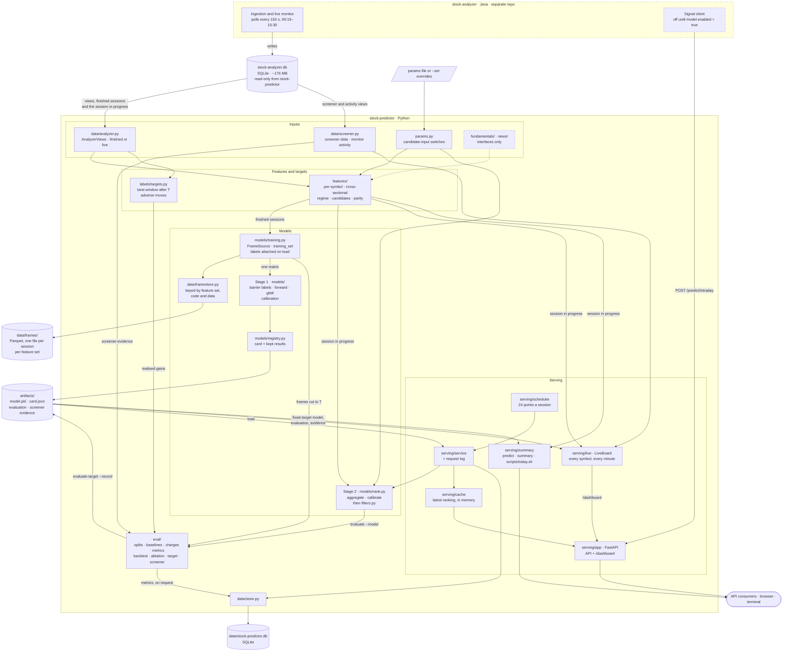

# Stock Predictor — Architecture

A companion to [DESIGN.md](DESIGN.md), which says what is predicted and why.
This page shows how the code is split into modules, how data moves through
them, where each piece of data is kept, what each session writes, and the
rules the code relies on. Figures were measured with 62 symbols and 108–111
finished sessions.

---

## 1. Modules



How to read it:

- **Data enters from one place.** `data/analyzer.py` is the only module that
  reads stock-analyzer's feature data. It reads the views in DESIGN 3.1 and
  one base table, `hot_window`, for the time-of-day baseline. With
  `live=True`, it reads today's session from `v_intraday_merged` and leaves
  out the candle still forming. `serve`, `predict`, `summary` and the live
  board read live; training and evaluation read finished sessions.
- **Screener data is shown and measured, never used as a feature.**
  `data/screener.py` reads stock-analyzer's fundamentals, CANSLIM runs,
  bullish score, watchlist, trades, holdings and monitor heartbeat. It is a
  separate module from `data/analyzer.py`, so changing it never invalidates
  the saved frames.
- **Finished sessions go through saved frames** (section 2.1). The session in
  progress never does: it changes every minute, so its frame is built fresh.
- **Models keep their evidence beside them.** A model's folder holds its
  pickled trees and a card, and may also hold:
  - its held-out evaluation;
  - its screener evidence.

  The card records the features, parameters, minute step, target, band and
  calibration. A model used live finds the evidence through the twin model
  trained on the same target without the held-out month.
- **Dashed boxes** are either outside this repo or not doing anything yet.
  `fundamentals/` and `news/` return nothing. stock-analyzer's signal client
  stays on its own time-of-day prior until `model.enabled=true` in its
  `application.properties`.
- **`cli.py`** is not drawn. Each command calls into one of the boxes above.

---

## 2. Data flows

### 2.1 Training and evaluation

```
finished sessions ──► FrameSource ──► saved feature frame (build once, ~7 s; read back in ~0.04 s)
                                         │
                       labels for the target, attached on load from the session's full candles
                                         │
                       training_set: one column-major float64 matrix, complete windows only,
                                     every K-th minute (--minute-step)
                                         │
                       fit: classifier + quantile band (+ calibration on the last 20 sessions)
                                         │
                       artifacts/<version>/  model.pkl · card.json
```

- **A saved frame holds features only, one Parquet file per session.** It is
  used only if three things match:
  - **feature set**: which candidate inputs are on as features;
  - **code**: a hash of `features/`, `data/analyzer.py`,
    `data/framestore.py`, `clock.py` and `params.py`, so no version needs
    bumping;
  - **data**: a hash chained through every session's minute and daily candles
    up to and including that one. If stock-analyzer rewrites an old session,
    that frame and every later one are rebuilt.

  Missing frames are built in `--jobs` processes; `--no-frame-cache` builds
  without saving.
- **Labels never touch the frames.** They are attached on load (well under a
  second per session), so a new target, horizon or band reuses every frame.
  Label code lives outside the fingerprinted files for that reason.
- **A model's name says how it was trained.** The target comes first, then
  `-recent<N>d` for a window of only the last N days and `-m<K>` for every
  K-th minute. The card also records the first and last session and the row
  count, and `stock-predictor models` lists them. Results kept beside a model
  are found by its recipe: target, band, window and minute step.
- **Evaluation reuses the same frames.** `evaluate --model`, `ablate --model`,
  `evaluate-target` and `screener-evidence` cut each one back to their
  prediction point. That is exact because every row depends only on candles
  at or before its own minute (DESIGN 2).

### 2.2 The session in progress

```
stock-analyzer daemon ──► live_candle ──► v_intraday_merged
                                              │  (finished candles only)
                              latest minute ≥ 90% of symbols have finished
                                              │
                              build_feature_frame(today, that minute)
                                              │
               predict · summary · live board · scheduled ranking
```

The live board refreshes every 20 s and recomputes only when the finished
minute moves. Each refresh takes about 6 s for 62 symbols, including the
"what moved it" sweep: each input group is set to the median stock's value,
and the batch is re-scored in one call.

### 2.3 The scheduled ranking

```
scheduler (T0, T1, every 15 min) ──► recompute ──► cache ──► /predictions/top
                                          └──► prediction table ──► score (next day)
```

With no ranking model served, the recompute falls back to the
`highest_volatility` baseline and labels the answer with that version.

### 2.4 The daily refresh

```
stock-analyzer evening batch (18:30) ──► candles for the day stored
                                              │
scripts/refresh.sh (launchd, 19:15) ──► wait until stored ──► scorecard (score the day's recorded picks)
                                              │
                    retrain each model in use on every finished session (frames built for the new one)
                                              │
                    Fridays: held-out checks again · prune superseded models (keep 3 of each kind)
```

Every step is idempotent; a missed run starts when the machine wakes. The
recorded picks (`summary_pick`) come from `today.sh` and `tomorrow.sh`, one
row per stock per run.

### 2.5 stock-analyzer's signal requests

```
stock-analyzer monitor ──► POST /predict/intraday (every tracked symbol, every poll)
                               │
                 request log (per symbol)  ·  intraday_signal (one row per candle, first answer kept)
```

---

## 3. Where the data is stored

| Store | Location (override) | Written by | Holds | Size |
|---|---|---|---|---|
| **stock-analyzer database** | `../stock-analyzer/data/stock-analyzer.db` (`STOCK_ANALYZER_DB`) | stock-analyzer only | Minute candles, daily bars, opportunity labels, screener data, live session state | ~176 MB, plus up to ~15 MB of WAL during a session |
| **stock-predictor database** | `data/stock-predictor.db` (`STOCK_PREDICTOR_DB`) | `serve`, `score`, `evaluate --record` | Tables `prediction`, `intraday_signal`, `metric_run` | Small; grows with `serve` (section 4) |
| **Saved training frames** | `data/frames/<feature set>/` (`STOCK_PREDICTOR_FRAMES`) | `train`, `evaluate*`, `ablate --model`, `screener-evidence` | Each finished session's feature frame, as Parquet. No labels: every target shares them | ~7 MB per session: 648 MB for 111 sessions |
| **Model artefacts** | `artifacts/<version>/` (`STOCK_PREDICTOR_ARTIFACTS`) | `train`, `evaluate-target --record`, `screener-evidence --record` | `model.pkl`, `card.json`, and `evaluation.json` / `screener_evidence.json` when recorded | ~2.7 MB per model |
| **Prediction cache** | Memory of `serve` | The scheduler | The latest ranking | Under 1 KB |
| **Live board** | Memory of `serve` | The board's thread | The latest snapshot of every symbol | ~200 KB of JSON |
| **Request log** | Memory of `serve` | `POST /predict/intraday` | Per-symbol request counts and last answers | Small |
| **Recorded picks** | `data/stock-predictor.db`, table `summary_pick` | `today.sh`, `tomorrow.sh` (`summary --record`); scored by `scorecard` | Every stock's prediction per run, and later its outcome | 62 rows a run, ~10 KB |
| **Refresh log** | `data/logs/refresh.log` | `scripts/refresh.sh` | What each daily refresh did | A few KB a day |
| **Training matrix** | Memory of `train` | `train` | One float64 matrix of features, plus labels | Section 5 |
| **Parameters** | `params.example.toml` or your own file (`STOCK_PREDICTOR_PARAMS`) | You | Candidate-input switches (DESIGN 4.1) | — |

Everything under `data/` and `artifacts/` is git-ignored. `stock-predictor
frames` lists the saved frames and their disk use. They are a cache: deleting
`data/frames/` costs only the time to rebuild them, about 2 minutes on 5
processes.

---

## 4. Daily churn

### stock-analyzer.db, written by stock-analyzer

| Table | Rows added per session | Bytes per session | Read by stock-predictor |
|---|---|---|---|
| `candle` (1-minute) | ~22,500 (62 symbols × ~363 minutes) | 1.16 MB | Yes, through `v_intraday_candles` |
| `daily_bar` (whole market) | ~2,740 | 0.18 MB | No |
| `gain_opportunity` (2 active detectors) | ~250 | ~40 KB | Yes, through `v_opportunity_markers` |
| `event`, `trading_day`, `alert_log`, `ingestion_failure` | ~370–530 | ~45–135 KB | `trading_day`, through `v_daily_candles` |
| **Net growth** | **~26,000** | **~1.4–1.5 MB** | |

Some tables are overwritten instead of growing:

- `live_candle` holds only the running session (~22,000 rows, ~2.2 MB by the
  close);
- `live_opportunity` is replaced on every poll;
- `hot_window` (2,372 rows) is recomputed once a day.

These overwrites are why the WAL reaches ~15 MB by the close.

Over about 250 sessions a year, that comes to roughly **360 MB a year**. At the
current universe, the database doubles in about six months. Each symbol added
costs about 19 KB per session.

### stock-predictor's own writes

| What | Per session | Notes |
|---|---|---|
| `prediction` | 120 rows (24 points × 5 picks), ~25 KB | `score` updates each row once the next day. About 6 MB a year |
| `intraday_signal` | 0 while stock-analyzer's model client is off | Then one row per symbol per candle: 23,250 rows, 1.8 MB (~450 MB a year) |
| Saved training frames | ~7 MB per feature set in use | Written once, the first time a finished session is used. About 1.8 GB a year for each feature set kept |
| `metric_run` | Only on `evaluate --record` | A few KB per run |
| `artifacts/` | ~2.7 MB per model trained, not per session | Old versions are never deleted. `today.sh` retrains after each finished session, so ~0.7 GB a year if run daily |

The saved frames are the largest thing stock-predictor writes: about five
times the growth of stock-analyzer's database, per feature set. They are
float64, so a saved frame is exactly what a fresh build would give. zstd
compression gets them to about half their in-memory size; other Parquet
settings made no difference.

The `prediction` and `intraday_signal` figures come from writing simulated
sessions through `Store` into a scratch database.

---

## 5. Performance and memory

**Signals are written once.** stock-analyzer re-sends each symbol's whole
session so far on every 150-second poll. `save_intraday_signals` inserts only
candles it has not stored, and keeps the first signal computed for each. A full
session writes 23,250 rows; rewriting every re-sent candle would have meant
1,753,050. A re-send never resets a filled `realized_return_pct`.

**Saved frames make training cheap to repeat.** Assembling 20 sessions takes
122 s when every frame is built, and 1.6 s from saved frames, plus ~1.3 s per
run to check that each one is current.

**The training matrix is built compactly.** Each session goes straight into
one column-major float64 array. scikit-learn copies a row-major matrix into
that layout before fitting, so building it that way avoids a full-size copy.
With 20 sessions, peak memory (macOS footprint) is 1,478 MB at every minute and
753 MB at every 5th minute; concatenating DataFrames first peaked at 1,806 MB.

**Every minute or every 5th?** Two stage-1 models were trained on the same 46
development sessions (2026-06-02 to 2026-08-05) and scored on 20 later
sessions (2026-09-07 to 2026-10-06), at T1:

| | Every minute | Every 5th minute |
|---|---|---|
| Training rows | 771,952 | 156,181 |
| Feature matrix | 519 MB | 105 MB |
| Peak memory (macOS footprint) | 2,061 MB | 852 MB |
| Training time | 240 s | 13 s |
| Realised net gain, top 5 | 1.41% | 1.35% |
| Precision@5 / NDCG@5 | 0.20 / 0.40 | 0.19 / 0.37 |
| Adverse rate | 24% | 22% |

Every 5th minute scores 0.06 percentage points lower, which twenty sessions
cannot distinguish from noise. The ranking's default stays at every minute.
The fixed-target models train on every 3rd minute: on all 111 sessions that is
~724,000 rows and a ~2.3 GB peak. A fit of classifier, band and calibration
takes ~2–5 minutes. For +0.5% before the close on 90 development sessions:

| | Rows | Peak memory | Time |
|---|---|---|---|
| Full history, every 3rd minute | 573k | 2.5 GB | 74 s |
| Full history, every minute | 1.71M | 4.3 GB | 154 s |
| Last 30 days, every minute | 427k | 1.9 GB | 38 s |
| Last 30 days, every 3rd minute | 143k | 0.9 GB | 20 s |

All four score within noise of each other on the held-out month (DESIGN 6.1).

At every minute, peak memory is about 2.9 times the matrix, because of
scikit-learn's own copies. Training the ranking on all sessions at every minute
would peak near 4 GB.

**First builds are the slow part**, at 6–9 s per session. Most of that is the
same-minute volume profiles (3.0 s) and the cross-sectional ranks (2.2 s, which
use Python's `statistics` module). Parallel builds hide it for training (~2
minutes for 111 sessions on 5 processes); live builds take it every refresh.

---

## 6. Rules the code relies on

- **Read-only, never immutable.** stock-analyzer's daemon writes all session
  long. A connection opened as `immutable` reads stale pages and, once a
  checkpoint rewrites them mid-read, fails with "database disk image is
  malformed". The connection is plain `mode=ro`.
- **One SQLite connection per thread.** The scheduler and the live board each
  have their own. A connection shared by two threads at once slows both to a
  crawl.
- **"Now" is the latest minute 90% of symbols have finished** (DESIGN 2), not
  the newest candle of any symbol.
- **Every row depends only on candles at or before its own minute.** Saved
  frames, the cut-back evaluation and live builds all assume it; a test
  enforces it.
- **Labels come from the session's full candles, in clock minutes.** A window
  that runs past the last candle is not trained on; a tie inside one candle
  counts as stopped.
- **The ground truth of a fixed target is the candles.** It needs no detector,
  so it uses every finished session. The ranking uses only sessions with final
  labels from the configured detector.

---

## 7. Still open

- **The ranking's detector stopped being produced.** stock-analyzer now writes
  `topk-nonoverlap/highlow/min0.5/hold5/v1`. The default here
  (`.../min0.5/v1`, `STOCK_PREDICTOR_DETECTOR`) ends at 2026-11-05, and so do
  `completed_sessions`, `evaluate` and `backtest`. Switching changes what a
  window is (DESIGN 11).
- **The scheduler can hit a partial minute.** It recomputes at fixed points
  (09:30, 09:45, ...). If stock-analyzer has not yet written that minute for
  most symbols, the recompute builds the cross-section from the ones it has.
  It should wait for the minute, as the live board and `predict` do.
- **The fixed-target models are untuned and only calibrated after the fact.**
  Neither beats ranking by current volatility (DESIGN 6.1).
- **Disk for saved frames and models.** About 1.8 GB a year per feature set,
  plus a model per retrain. Delete `data/frames/<feature set>/` for feature
  sets no longer in use, and old `artifacts/` versions when they are no
  longer needed.
- **First builds are slow** (section 5). Vectorising the volume profiles and
  cross-sectional ranks would shorten them and every live refresh.
- **At every minute, scikit-learn sets the memory peak.** It holds out 10% of
  rows for early stopping by copying the whole matrix again. Only
  `--minute-step`, or fewer sessions, reduces that.
