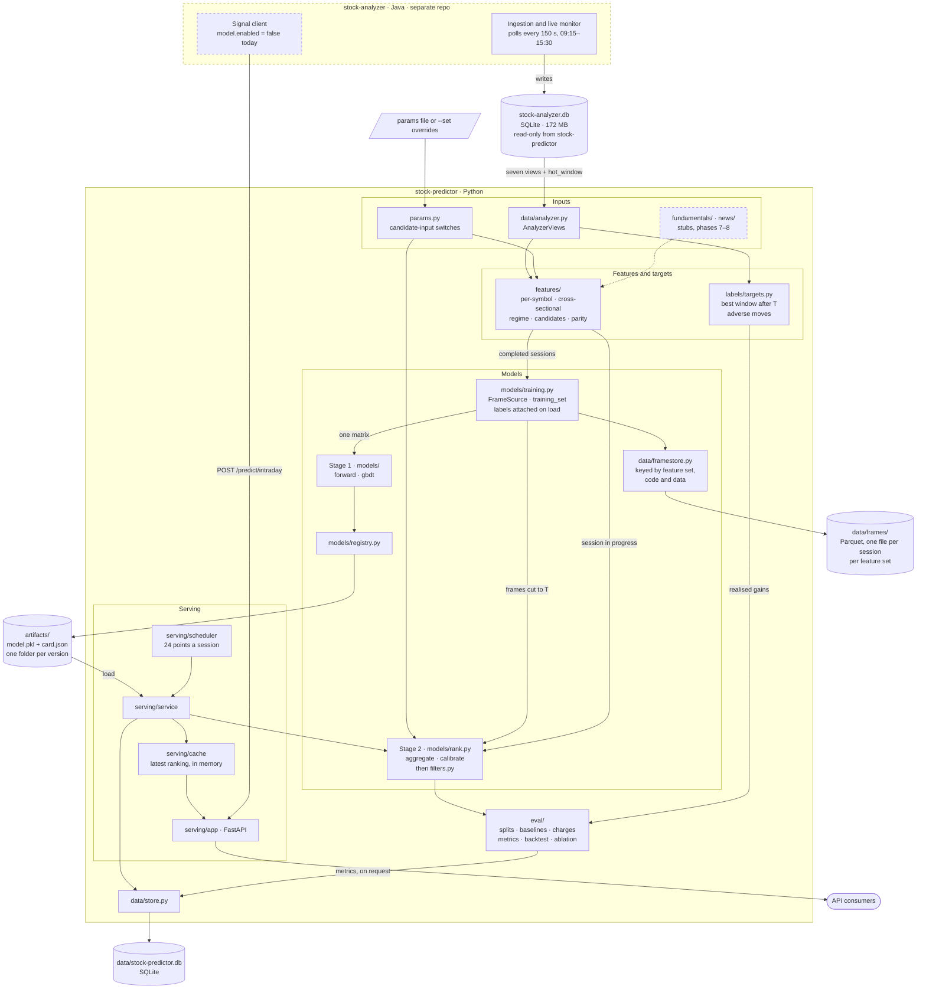

# Stock Predictor — modules, storage and daily churn

A companion to [DESIGN.md](DESIGN.md). It shows how the code is split into
modules, where each piece of data is kept, and how much is written each
session. All figures were measured on 2026-11-05, with 62 symbols and 108
completed sessions.

---

## 1. Modules

How to read it:

- **Data enters from one place.** `data/analyzer.py` is the only module that
  touches stock-analyzer's database. It opens the file read-only. It reads six
  views (`v_intraday_candles`, `v_daily_candles`, `v_opportunity_markers`,
  `v_symbol_trend`, `v_market_breadth`, `v_symbol_beta`) and one base table,
  `hot_window`, for the time-of-day baseline.
- **The session in progress comes from a seventh view.** stock-analyzer writes
  a day's candles to `v_intraday_candles` only after the close. During the
  session its daemon records each finished minute in `live_candle`, which
  `v_intraday_merged` combines with the finished sessions. `serve` and
  `predict` open the views with `live=True`, which reads today from that view
  and leaves out the candle still forming. Everything else a feature needs
  comes from sessions before today.
- **Completed sessions go through saved frames.** `models/training.py` reads
  each completed session's feature frame from `data/frames/`. If a frame is
  missing or out of date, it builds the frame and saves it (`--jobs`
  processes at once). Labels for the target being trained are attached on
  load, from the session's full minute candles. `train` turns the frames into
  one matrix. `evaluate --model`, `evaluate-target` and `ablate --model` cut
  them back to their prediction point. The session in progress never touches
  the store; serving builds its frame fresh at each point.
- **Dashed boxes** are either outside this repo or not doing anything yet.
  `fundamentals/` and `news/` return nothing. stock-analyzer's signal client is
  switched off (`model.enabled=false` in its `application.properties`).
- **`cli.py`** is not drawn. Each of its commands calls into one of the boxes
  above.

---

## 2. Where the data is stored

| Store | Location (override) | Written by | Holds | Size today |
|---|---|---|---|---|
| **stock-analyzer database** | `../stock-analyzer/data/stock-analyzer.db` (`STOCK_ANALYZER_DB`) | stock-analyzer only | Minute candles, daily bars, opportunity labels, live session state | 172 MB, plus 15 MB of uncheckpointed WAL during today's session |
| **stock-predictor database** | `data/stock-predictor.db` (`STOCK_PREDICTOR_DB`) | `serve`, `score`, `evaluate --record` | Tables `prediction`, `intraday_signal`, `metric_run` | Does not exist yet: nothing has run `serve` |
| **Saved training frames** | `data/frames/<feature set>/` (`STOCK_PREDICTOR_FRAMES`) | `train`, `evaluate --model`, `evaluate-target`, `ablate --model` | Each completed session's feature frame, as Parquet. No labels: every target shares them | About 7 MB per session, so ~0.8 GB for 109 sessions |
| **Model artefacts** | `artifacts/<version>/` (`STOCK_PREDICTOR_ARTIFACTS`) | `train` | `model.pkl` (pickled trees) and `card.json` (features, params, minute step, target, calibration) | One model is 2.7 MB |
| **Prediction cache** | Memory of the `serve` process | The scheduler | The latest ranking only | Under 1 KB |
| **Training matrix** | Memory of `train` | `train` | One float64 matrix of features, plus labels | See section 4 |
| **Parameters** | `params.example.toml` or your own file (`STOCK_PREDICTOR_PARAMS`) | You | Candidate-input switches (DESIGN 4.1) | — |

Everything under `data/` and `artifacts/` is git-ignored. `stock-predictor
frames` lists the saved frames and their disk use. They are a cache: deleting
`data/frames/` costs only the time to rebuild them.

---

## 3. Daily churn

### stock-analyzer.db, written by stock-analyzer

| Table | Rows added per session | Bytes per session | Read by stock-predictor |
|---|---|---|---|
| `candle` (1-minute) | ~22,500 (62 symbols × ~363 minutes) | 1.16 MB | Yes, through `v_intraday_candles` |
| `daily_bar` (whole market) | ~2,740 | 0.18 MB | No |
| `gain_opportunity` (2 active detectors) | ~250 | ~40 KB | Yes, through `v_opportunity_markers` |
| `event`, `trading_day`, `alert_log`, `ingestion_failure` | ~370–530 | ~45–135 KB | `trading_day`, through `v_daily_candles` |
| **Net growth** | **~26,000** | **~1.4–1.5 MB** | |

Some tables are overwritten instead of growing:

- `live_candle` holds only the running session (22,425 rows, 2.2 MB).
- `live_opportunity` is replaced on every poll.
- `hot_window` (2,372 rows) is recomputed once a day.

These overwrites are why the WAL had reached 15 MB by 15:29 today.

Over about 250 sessions a year, that comes to roughly **360 MB a year**. At the
current universe, the database doubles in under six months. Each symbol
added costs about 19 KB per session.

### stock-predictor's own writes

| What | Per session | Notes |
|---|---|---|
| `prediction` | 120 rows (24 points × 5 picks), ~25 KB | `score` updates each row once the next day. About 6 MB a year |
| `intraday_signal` | 0 today | Stays empty until stock-analyzer switches `model.enabled` on. Then one row per symbol per candle: 23,250 rows, 1.8 MB (~450 MB a year) |
| Saved training frames | ~7 MB per feature set in use | Written once, the first time a completed session is used. About 1.8 GB a year for each feature set kept |
| `metric_run` | Only on `evaluate --record` | A few KB per run |
| `artifacts/` | 2.7 MB per retrain, not per session | Old versions are never deleted. Retraining monthly adds ~33 MB a year |

The saved frames are now the largest thing stock-predictor writes. They
total about five times the growth of stock-analyzer's database, for one
feature set. They are float64 so that a saved frame is exactly what a fresh
build would give. zstd compression gets them to about half their in-memory
size; other Parquet settings made no difference.

The `prediction` and `intraday_signal` figures come from writing simulated
sessions through `Store` into a scratch database.

---

## 4. Changes made on 2026-11-05

The first version of this page found two problems: signal storage rewriting
almost everything it kept, and training memory that grows without bound.
Both are fixed. Fixing the second exposed a leak in the training frames.

| | Before | After |
|---|---|---|
| `intraday_signal` rows written per session, once switched on | 1,753,050 | 23,250, one per candle |
| Assembling 20 sessions for `train` | 122 s, rebuilt every time | 1.6 s from saved frames, plus ~1.3 s once per run to check them |
| Peak memory, training on 20 sessions (macOS footprint) | 1,806 MB | 1,478 MB every minute; 753 MB every 5th minute |
| Training rows that saw the 15:00 close | Every row before 15:00 | None |

**Signals are written once.** stock-analyzer sends each symbol's completed
candles for the whole session so far on every 150-second poll.
`save_intraday_signals` used to rewrite all of them. Now it inserts only
candles it has not stored, and keeps the first signal computed for each. A
re-send also no longer resets a filled `realized_return_pct` to empty.

**Training frames are saved per session.** A frame is reused only if it was
built from the same feature set, the same frame-building code (a hash of the
source files, so no version needs bumping), and the same data. The data
check is a hash chained through every session's minute and daily candles up
to and including that one. If stock-analyzer rewrites an old session, that
frame and every later one are rebuilt. `--no-frame-cache` turns all of this
off.

**The training matrix is built compactly.** It used to be a DataFrame per
session, concatenated, then copied into a matrix. Now each session goes
straight into one column-major float64 array. scikit-learn copies a
row-major matrix into that layout before fitting, so building it that way
avoids a full-size copy. `train --minute-step K` keeps every K-th minute after the open.
The model card records K.

**Every minute or every 5th?** Both models were trained on the same 46
development sessions (2026-06-02 to 2026-08-05) and scored on 20 later
sessions (2026-09-07 to 2026-10-06), at T1:

| | Every minute | Every 5th minute |
|---|---|---|
| Training rows | 771,952 | 156,181 |
| Feature matrix | 519 MB | 105 MB |
| Peak memory (macOS footprint) | 2,061 MB | 852 MB |
| Training time | 240 s | 13 s |
| Realised net gain, top 5 | 1.41% | 1.35% |
| Precision@5 / NDCG@5 | 0.20 / 0.40 | 0.19 / 0.37 |
| Adverse rate | 24% | 22% |

Every 5th minute scores 0.06 percentage points lower. Twenty sessions are too
few to tell whether that difference is real. The default stays at every minute
until a walk-forward comparison over more sessions settles it. Both models
trail `highest_volatility`, which made 2.43% on the same sessions. With only
46 training sessions, that does not settle anything about the model either.

At every minute, peak memory is about 2.9 times the matrix, because of
scikit-learn's own copies; it was about 4 times before. Projected to all 108
sessions, training would peak at roughly 4 GB at every minute (about 5.5 GB
before these changes) and about 1.3 GB at every 5th minute.

**The leak.** Saved frames are only correct if each row's values don't
depend on how late the frame was built. Checking that turned up two features
that broke the leakage rule. The distances from the 5-, 20- and 50-day
averages used the build-time close, so in a frame built to 15:00, every 09:30
row knew the day's 15:00 price. The regime clock was 345 minutes on every
row. Both are now computed per row. Beta is now computed point-in-time as
well (DESIGN section 4). Any model trained before this change learned from
the leaked values and should be retrained.

## 5. Changes made on 2026-11-06

Training a model for a fixed target (+1% within 40 minutes) and running it on
the live session turned up three problems with reading the session in
progress, and one with labels:

- **Reading during market hours could fail.** The connection was opened with
  `immutable=1`, which tells SQLite the file never changes. While
  stock-analyzer's daemon is writing, that returns stale pages. A long read
  (an evaluation over 108 sessions) failed with "database disk image is
  malformed" twice at 14:30 today. The connection is now plain read-only.
- **`serve` never used its model during a session.** Today's candles reach
  `v_intraday_candles` only after the close, so every recompute at 09:30 to
  15:00 found no features and silently served the `highest_volatility`
  baseline instead. `serve` now reads the session in progress from
  `v_intraday_merged` (section 1).
- **Labels stopped at 15:00.** Frames run to the last prediction point, and
  labels were computed from the frame's own candles, so a 14:45 row's window
  ended at 15:00, not 15:15. Labels are now attached from the session's full
  candles, and a row whose window runs past 15:29 is not trained on. Windows
  are measured in clock minutes, so a minute with no trades no longer
  stretches a window. When one candle reaches both barriers, the row now
  counts as stopped, because the order inside the candle is unknown.
- **The newest live minute is usually partial.** stock-analyzer writes the
  session a symbol at a time, and polls two symbols more often than the rest.
  At 14:45 the newest finished minute (14:44) held 2 of 62 symbols, so
  predicting "now" ranked those 2 against each other in the cross-sectional
  features. `predict` now uses the latest minute at least 90% of symbols have
  finished, which runs about 3 minutes behind the clock.
- **A new target rebuilt every frame.** Labels were saved inside the frames,
  and a different target meant 13 minutes of rebuilding. Frames now hold
  features only, and a missing frame is built in `--jobs` processes: 109
  sessions in about 2 minutes on 5.

---

## 6. Still open

- **The scheduler can hit a partial minute too.** `serve` recomputes at fixed
  points (09:30, 09:45, ...). A recompute that fires before stock-analyzer has
  written that minute for most symbols builds the cross-section from the
  symbols it has. It should wait for the minute, as `predict` does.
- **The +1% / 40-minute model is overconfident above about 20%** and does not
  beat ranking by current volatility (README). `predict` shows the calibrated
  figure; the model itself has not been tuned.

- **Disk for saved frames.** About 7 MB per session per feature set, so
  ~0.8 GB today and about 1.8 GB more each year. Delete
  `data/frames/<feature set>/` for feature sets no longer in use.
- **The first build is still slow,** at 6–9 s per session. Most of that is the
  same-minute volume profiles (3.0 s) and the cross-sectional ranks (2.2 s,
  which use Python's `statistics` module). Vectorising them would shorten
  first builds and serving recomputes. Repeat runs are already fast.
- **At every minute, scikit-learn sets the memory peak.** It holds out 10% of
  rows for early stopping by copying the whole matrix again. Only
  `--minute-step`, or a smaller window of sessions, reduces that.
